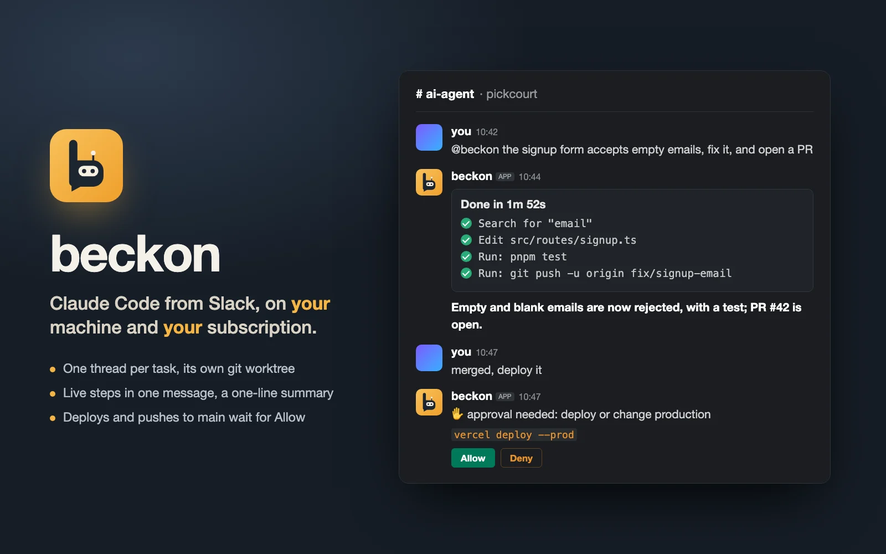

<p align="center"></p>

# beckon

<p align="center"></p>

Run Claude Code from Slack, on your own machine, with your own Claude subscription.

Mention `@beckon` with a task. It starts Claude Code in a fresh git worktree of the right repository, shows its steps live in the thread, and posts the answer there. Reply in the thread to keep going; a reply while it works reaches the run right away (:speech_balloon:). When Claude wants to deploy, push to `main`, merge, run a migration or publish, the command waits in Slack for you to press **Allow** or **Deny**.

```
#myapp
  you      @beckon the signup form accepts empty emails, fix it and open a PR
  beckon   ⏳ Working · 1m 12s
           • Search for `email`
           • Edit `src/routes/signup.ts`
           • Run `npm test`
           • Run `git push -u origin fix/signup-empty-email`
  beckon   Fixed: empty and whitespace-only emails are now rejected, with a test.
           PR: https://github.com/you/myapp/pull/42
  you      looks good, deploy it
  beckon   ✋ approval needed: deploy or change production
           vercel deploy --prod
           [Allow] [Deny]
```

## Why

- **Your machine, your tools.** Claude runs where your repositories, CLIs (`gh`, `vercel`, `wrangler`, `supabase` and so on) and logins already are. It reads each repository's own `CLAUDE.md`, skills, hooks and MCP servers, just like when you run `claude` yourself.
- **Your subscription.** beckon starts the official `claude` CLI, logged in with your Claude plan. It strips `ANTHROPIC_API_KEY` from Claude's environment so a stray key in your shell does not move you to API billing.
- **Safe to leave running.** Risky actions always wait for a button press, whatever the permission mode. Anything that would show a permission prompt also comes to Slack instead of failing. Only the Slack members you list can give beckon work or press its buttons.
- **No public URL.** Slack Socket Mode means beckon opens the connection from your side. It runs behind NAT on a laptop or a home server.

## Requirements

- Node.js 22 or newer, git, and [Claude Code](https://code.claude.com/docs) installed and logged in on the host
- macOS or Linux
- A Slack workspace where you can create an app

## Set up

1. **Install**

   ```sh
   npm install -g github:openyard-cloud/beckon
   beckon init
   ```

   This creates `~/.beckon/config.json` and `~/.beckon/env`.

2. **Create the Slack app.** Open <https://api.slack.com/apps?new_app=1>, choose *From a manifest*, and paste the output of `beckon manifest`. Install the app to your workspace.
   - Copy *OAuth & Permissions > Bot User OAuth Token* (`xoxb-...`) into `~/.beckon/env` as `SLACK_BOT_TOKEN`.
   - Under *Basic Information > App-Level Tokens*, generate a token with the `connections:write` scope. Copy it (`xapp-...`) into the same file as `SLACK_APP_TOKEN`.

3. **Configure** `~/.beckon/config.json`: your Slack member ID (*profile > ⋯ > Copy member ID*) and at least one project. You can add more projects and channels from Slack later (see [Managing projects from Slack](#managing-projects-from-slack)).

4. **Invite beckon** into each project channel with `/invite @beckon`.

5. **Check and run**

   ```sh
   beckon doctor           # checks node, claude login, git, config and both tokens
   beckon start            # foreground
   beckon service install  # background, starts on login (launchd on macOS, systemd on Linux)
   ```

## Using it

### Give it work

| You do | beckon does |
| --- | --- |
| Mention `@beckon <task>` in a project's channel | Starts a new thread, worktree and Claude session |
| Reply in that thread (no mention needed) | Continues the same session |
| DM beckon | Same, in the default project |
| Start with `otherproject: <task>`, anywhere | Uses that project instead (case does not matter) |
| Mention `@beckon` inside an existing discussion thread | Reads the thread first, then works on your request |
| Reply `stop`, or press **Stop** | Stops the current run; reply again to continue |
| Mention `@beckon status` | Lists what is running and queued, per project |
| Mention `@beckon help` | Lists the commands, the projects and their channels |

Each task runs in its own worktree under `~/.beckon/worktrees`, created from the latest remote copy of the base branch on a detached HEAD. Claude creates a branch with your repository's naming conventions, so several tasks on one repository never collide. A worktree that has been idle for `keepDays` is removed, but only if that loses nothing: uncommitted changes and commits that are not on any branch keep it alive.

Claude closes the browser tabs it opened before it finishes. Tabs opened with Claude in Chrome are tracked, and a run that tries to end with some still open is sent back to close them (twice at most). It also deletes the files it made only to check something (screenshots, scripts, logs) and does not point you to files on the machine, which you cannot open from Slack; ask if you want one shared.

**Screenshots and recordings.** Ask to see one ("quay video test checkout gửi lên đây") and Claude sends it to the thread with `beckon-attach`:

```sh
beckon-attach $TMPDIR/checkout.mp4 --title "Checkout on iPhone 15" --comment "Pay button works again"
```

Only images, videos and PDFs go (up to 1 GB), checked by their content rather than their name, so a settings or key file cannot be sent by renaming it. A file in a temporary folder is deleted once it is in Slack. In a team, the lead hands the command to the member doing the recording. This needs the `files:write` scope: apps made from an older manifest add it under *OAuth & Permissions > Bot Token Scopes* and reinstall the app. Until then Claude says the file could not be sent. Ask for another place ("upload to Google Drive") and it goes there instead.

### Which project a message goes to

beckon can serve any number of projects. Each one is a git repository on the machine beckon runs on. A new message picks its project in this order:

1. **A `project:` prefix.** `@beckon hush: fix the build` goes to `hush` from any channel or DM, whatever the channel is linked to. Case does not matter: `Hush:` works too.
2. **The channel.** A message in a channel linked to a project goes to that project. A channel belongs to one project at most, and a project can have several channels.
3. **The default project, in DMs.** A DM without a prefix goes to `defaultProject`. With a single project, that project is the default.
4. **Otherwise nothing runs.** In a channel that is not linked to a project, beckon replies with the project names and asks for a prefix.

A thread keeps the project its first message picked. Replies in it go to the same project even if they start with another project's name, so start a new message to switch projects.

The simplest setup is one channel per project (`#myapp-agent`, `#website-agent`) and your busiest project as the default for DMs.

### Agents: PM, dev, designer, QA

A project can have a team of agents, each a role with its own instructions, tools and skills: for example `pm`, `dev`, `designer` and `qa`. They work in the project's channel, each under its own name and icon, and know about each other. Tag one to give it a task:

```
@pm write the spec for club rankings by month
@qa check the booking flow on the web app
```

In a project's channel, a message that starts with an agent's tag goes to that agent without mentioning beckon. `@beckon qa: ...` and `@beckon pickcourt: qa: ...` work too, also from other channels and DMs. Without a tag, a task goes to the agent of the channel (an agent's `channels`), else to the project's `defaultAgent`, else to plain Claude Code.

**Agents hand work to each other.** An agent that finishes its part and ends its answer with a line like `@qa check the booking flow in PR #412` gives the thread to that agent, which carries on in the same session and worktree. So `@pm` can write a spec and hand it to `@dev`, who opens the pull request and hands it to `@qa`. To stop agents passing work back and forth forever, beckon allows `maxHandoffs` (default 3) hand-overs in a row; then it waits for a person. Any message from a person starts the count again, and a reply that starts with a tag hands the thread to that agent.

Each agent runs one of Claude Code's own agents (`claude --agent <name>`). Give it a `prompt` and beckon defines it on the spot (`--agents`), so a new role needs only a few lines in the config, or a form in beckon desktop. Without a `prompt`, it is a file in the repository's `.claude/agents/` (or in `~/.claude/agents/`) with the role's prompt, its tools and its model. Its `skills` are folders that hold `skills/<name>/SKILL.md`; beckon loads each one as a plugin for that agent's runs only (`--plugin-dir`), so a skill for QA is not in the PM's way. Keep both in the repository, so the team edits them in pull requests:

```jsonc
"projects": {
  "myapp": {
    "path": "~/code/myapp",
    "channels": ["#myapp", "#myapp-design"],
    "agents": {
      "pm":       { "description": "specs, priorities, product numbers", "skills": ".claude/roles/pm" },
      "dev":      { "agent": "senior-dev", "skills": ".claude/roles/dev" },  // agent: the file's name, if it differs
      "designer": { "skills": ".claude/roles/designer", "channels": ["#myapp-design"] },
      "qa":       { "skills": ".claude/roles/qa", "model": "sonnet", "icon": ":test_tube:" },
      "writer":   { "description": "release notes, store texts", "prompt": "You write short, plain release notes and store texts in Vietnamese." }
    },
    "defaultAgent": "dev"
  }
}
```

An agent can also set its own `model`, `permissionMode`, `displayName` (default: `PM`, `DEV`, `QA`, `Designer`) and `icon` (an emoji or an https image; defaults for pm, dev, designer and qa). Schedules and watches take an `agent` too, like a morning report from `pm` or alert investigations by `dev`; without one, they use the project's `defaultAgent`. An agent file must list the `Skill` tool in its `tools` (or leave `tools` out) to use its skills.

Agents post under their own name and icon when beckon's Slack app has the `chat:write.customize` scope. Apps made from an older manifest lack it: add it under *OAuth & Permissions > Bot Token Scopes* and reinstall the app. Until then agents post as beckon, with the agent's name above the answer. A project's `lead` always posts that way: it is who people talk to, so it speaks as beckon.

**A lead agent runs the team.** With `"lead": "pm"`, you give the work to the lead only, and it gets it done through the others without you passing anything on. The lead starts the members as Claude Code subagents (the Agent tool, with each member's `agent` as its subagent type), in its own session and worktree: tasks that do not depend on each other run at the same time, and a task that needs another's result (testing after the code) starts once that result is in. beckon loads every member's skills into the lead's session for this. Slack shows only the lead: each member is a line on the lead's progress card while it works, ticked off with the first line of its report, and the lead's final report carries what matters and mentions you. Each member's full report is in beckon desktop, under the thread's run. A task you give a member directly stays with that member.

Members started as subagents share the lead's worktree, so the lead is told never to run two at once that edit the same files. They see only the task the lead gives them, not beckon's own instructions, so the lead passes on what they need (risky actions still wait for your Allow button). A lead can also hand work on with tags at the end of its answer (`@dev ...`, one line per task): beckon then runs those as turns of their own, one after another, and gives the lead the turn back when they are done; `maxHandoffs` caps those turns.

### Managing projects from Slack

Mention beckon with one of these, or send it in a DM. Only the members in `users` can use them. Each one edits `~/.beckon/config.json` and takes effect at once, without a restart.

| Command | What it does |
| --- | --- |
| `projects` | Lists the projects, their folders and channels, the default, and what is running |
| `add project <name> <path> [#channel ...]` | Adds a git repository on the beckon machine, optionally linked to channels. Example: `add project website ~/code/website #website-agent` |
| `link <project>` | In a channel: sends that channel's tasks to the project, moving it away from the project it had |
| `link #channel <project>` | The same, for another channel |
| `unlink`, or `unlink #channel` | The channel is no longer linked; messages there need a `project:` prefix |
| `default <project>` | The project DMs go to |
| `remove project <name>` | Takes the project out of beckon. The repository, branches and worktrees are not touched |

A few things are checked before anything is saved:
- `add project` needs a folder that exists and is a git repository, and a name that is not taken. Names ignore case and use letters, digits, dot, dash and underscore.
- `remove project` waits until the project has nothing running or queued, refuses to remove the last project, and refuses while a schedule still uses it.
- The edited config must still be valid, or nothing is written.

beckon only sees channels it is a member of. When you link a channel beckon is not in yet, the reply tells you, and you type `/invite @beckon` in that channel. This is required for private channels.

Commands have a fixed shape, so a task that happens to start with the same word still goes to Claude: `link the PR to the issue` is a task, not a command.

### Editing the config file

You can also edit `~/.beckon/config.json` by hand. beckon notices the change and applies it within a second, without a restart:
- Projects, channels, the default project, schedules, watches, `users` and the numeric settings change for new work.
- A run already going keeps the settings it started with.
- If the new file is not valid JSON or has problems, beckon keeps the config it has and writes the problems to its log (`~/.beckon/logs/beckon.log`). Run `beckon doctor` to see them.

### Watching an alert channel

beckon can look into alerts as they arrive, without a mention. Add a `watches` entry to the config with the channel your monitoring posts to, the project to investigate in, and a `match` regex for the messages that mean something is wrong:

```jsonc
"watches": [
  { "name": "backend alerts", "channel": "#myapp-alerts", "project": "myapp", "match": ":red_circle:|ERROR" }
]
```

Then `/invite @beckon` to that channel.

- **Which messages.** New top-level messages whose text or attachments match `match`, from anyone, including bots and webhooks. Recovery messages, replies in threads and beckon's own posts do not match. With `from`, only those senders count.
- **What it does.** beckon reacts with :eyes: and starts a run in the alert's thread. By default Claude only investigates: it reads logs, deploys and code, then replies with the cause, whether it is still happening, what it affected and a suggested fix. Set `prompt` to ask for something else. Reply in the thread to continue, for example "fix it".
- **One run per incident.** An alert that comes within `cooldownMinutes` of the previous one (60 by default) gets a link to the running investigation instead of a new run. A flapping service therefore keeps one thread until it has been quiet for that long.
- **Trust.** The alert text goes to Claude marked as data, not instructions, and the usual approvals still apply. Still, anyone who can post in the channel can start a run, so use `from` when the channel is open to others.

## Approvals

Three kinds of requests come to Slack:

1. **Always asked**, even in `bypassPermissions` mode and even when your settings allow the command:
   - a push to `main`, `master`, `production` or `release`, a force push, or a branch delete;
   - `gh pr merge`; releases, repository settings, and `gh api` calls with POST, PUT, PATCH or DELETE;
   - production deploys and changes on Vercel, Cloudflare (`wrangler`), Koyeb, Supabase, Fly, Railway, Netlify, Firebase, EAS and Heroku;
   - publishing to npm, PyPI, crates.io or RubyGems, and `docker push`;
   - Terraform, kubectl, Helm, and changes made with the AWS, Google Cloud and Azure CLIs;
   - direct database clients (`psql`, `mysql`, `mongosh`, `redis-cli`, ...);
   - `sudo`, and recursive deletes outside the worktree (temporary folders such as `/tmp` do not count);
   - MCP connector tools that deploy, migrate, delete, merge, publish or send messages;
   - clicks on consequential buttons on screen (Submit, Upload, Distribute, Release, Delete, ...), when screen control is set up (see below).

   The full list is in [`src/policy.mjs`](src/policy.mjs). Add your own per project with `alwaysAsk`. Let a project run some of these without asking with `autoAllow` and the rules' ids: `push-main`, `merge`, `github`, `deploy`, `release`, `publish`, `infra`, `database`, `root-delete`, `connector`, `screen-click`, `screen-agent`, `browser-submit`. For example `"autoAllow": ["merge"]` lets agents merge their pull requests; mind what a merge sets off, such as a deploy on push to main. Reading through a connector never asks, also under your own rules: tools named `get_…`, `list_…`, `search_…` and the like, and `execute_sql` with SQL that only reads. A rule with `"reads": true` asks for those too. Text a command only carries does not count either, for your rules as for these: a deploy command written into a file (`cat > notes.md <<'EOF'`), quoted in a sed script or a PR body, or in a string of a Python script. Text a shell runs still counts (`sh -c '...'`, `ssh host '...'`, `bash <<'EOF'`).

2. **Permission prompts.** These are tool uses your permission mode and allow rules do not already cover. **Allow everything in this thread** stops these prompts for the rest of that thread. Always-asked actions still ask.

3. **Looking outside the project.** An agent works on its own project only, and is told so. A file tool or command that names a path in a neighbouring folder (another repository next to the project, say `~/Projects/other` beside `~/Projects/pickcourt`) or in beckon's own data (`~/.beckon`: settings, tokens, other threads' worktrees) waits for Allow. One Allow covers that folder for the rest of the thread, and **Allow everything in this thread** covers these too. This catches paths written out in full; it is a guard against wandering off, not a sandbox.

When a request is denied, Claude is told not to reach the same result another way. A request nobody answers within `approvalTimeoutMinutes` is denied.

## Screen control (optional)

Some work has no command line: a dialog in Xcode, a form in a web console. beckon can give Claude the screen through [openyard-cloud/Peekaboo](https://github.com/openyard-cloud/Peekaboo), a fork of Peekaboo with an [action guard](https://github.com/openyard-cloud/Peekaboo/blob/main/docs/openyard-guard.md):

- A click on a button whose label names a consequential step (Submit, Upload, Distribute, Release, Delete, ...) is refused until Claude repeats it with `confirm` set to that label. beckon turns the repeat into an **Allow / Deny** message in Slack that shows the label.
- Typing into password fields is refused. Sign-ins stay with you.
- Other clicks, typing and screenshots run without asking.
- In Chrome (Peekaboo's `browser` tool), the guard cannot read the page, so actions that can submit (click, key presses, uploads, dialogs, raw DevTools calls) ask every time. Navigating, reading and filling fields do not.
- Peekaboo's own `agent` tool, which acts step by step out of beckon's sight, always asks.

Set it up once on the beckon machine:

1. Build the CLI (Xcode 26 or newer):

   ```sh
   git clone --recurse-submodules https://github.com/openyard-cloud/Peekaboo ~/Projects/peekaboo
   cd ~/Projects/peekaboo
   python3 scripts/setup-swift-workspace.py run -- swift build --package-path Apps/CLI -c release
   ```

2. Give the binary **Screen Recording** and **Accessibility** in *System Settings > Privacy & Security*, and check with `peekaboo permissions status`. An unsigned build is identified by its hash, so grant again after each rebuild.

3. List it in an MCP config file, for example `~/.beckon/mcp-screen.json`:

   ```json
   { "mcpServers": { "peekaboo": { "command": "/Users/you/Projects/peekaboo/Apps/CLI/.build/release/peekaboo", "args": ["mcp"] } } }
   ```

4. Point the projects that should have it at the file with `"mcpConfig": "~/.beckon/mcp-screen.json"`. Only those projects' runs get screen control. Your own `claude` sessions do not.

Screen control acts on the real desktop of the beckon machine. Keep it to the projects that need it, and keep that machine's sessions to what you would let the agent see. The guard does not check key presses (Return in a form can still submit it) or coordinate clicks outside Xcode and Transporter.

## Passwords, codes and other secrets (optional)

Claude never types a password or a one-time code, and never asks for one in Slack. When a sign-in needs one, the secret goes from your phone straight into the field, through a relay you deploy to your own Cloudflare account:

1. Claude clicks the field, then runs `beckon-secret --label "Apple ID password" --kind password --app "Google Chrome" --domain apple.com`.
   For a one-time code or PIN (`--kind otp`), beckon types one character at a time and checks the field again before each, so codes split into a box per digit work too.
2. The thread says what is being asked for. Each member in `users` gets a DM with an **Enter securely** link.
3. The link opens a one-time page on your relay. You type the value. The page encrypts it on the phone to a key that exists only in beckon on the Mac, and you confirm with your passkey (Face ID or Touch ID).
4. The relay hands the ciphertext to beckon over beckon's own outbound connection. beckon then:
   - checks the passkey signature;
   - decrypts the value;
   - reads the focused field through Accessibility and checks it: the app is the one named, a password goes into a password field, and for web pages the address is `https://` on the named domain or one of its subdomains.

   If any check fails, nothing is typed, and Claude is told why.
5. beckon types the value with Peekaboo's `type --secret-stdin` and overwrites it in memory. Claude only learns `filled`, `refused`, `cancelled` or `expired`.

```
phone ──(TLS: ciphertext + passkey signature)──▶ relay on Cloudflare ◀──(outbound WebSocket)── beckon on the Mac ──▶ focused field
```

How the secret is protected:

| Concern | How it is handled |
| --- | --- |
| The relay and Cloudflare | Only ever handle ciphertext. Each request gets a new ECDH P-256 key pair on the Mac. Its public half travels in the link's `#fragment`, which browsers never send to a server. The phone encrypts with HKDF-SHA256 and AES-256-GCM, bound to the request id. The private half never leaves beckon |
| Someone else with the link | Cannot read anything: there is nothing to read. They also cannot submit a value of their own, because beckon requires your passkey's signature over the exact ciphertext, with user verification. A value signed by another passkey, without Face ID or Touch ID, on another site, or swapped after signing is refused |
| The connection to the relay | beckon dials out, so no port is opened on the Mac. The relay sends a random challenge and beckon answers with an HMAC under `BECKON_RELAY_TOKEN`, so the token never crosses the wire. A new connection replaces the old one |
| The link | 256 random bits, one use, expires after `ttlMinutes` (5 by default). Sent by DM; the thread only says that a secret was requested. The page drops the key from the address bar as soon as it opens |
| The page | One script, served by your relay (`script-src 'self'`), and no third-party code. Strict CSP, `no-store`, no referrer, no framing, HSTS. Posts must come from the page's own origin. Request logs are off |
| The value on the Mac | Held as bytes and never made into a string. Passed to Peekaboo on stdin, so it never shows in the process list. Not logged, not put on the clipboard, not sent to Slack or Claude, and wiped after typing |
| Wrong field | The focus check runs just before typing. Domains must match whole labels, so `apple.com.evil.io` and `evilapple.com` do not pass |

Set it up once:

1. Deploy the relay from `relay/` to your Cloudflare account. It runs on the free plan: one Worker and one Durable Object.

   ```sh
   cd relay
   npx wrangler deploy                      # prints https://beckon-relay.<you>.workers.dev
   TOKEN=$(node -e "process.stdout.write(require('crypto').randomBytes(48).toString('base64url'))")
   printf '%s' "$TOKEN" | npx wrangler secret put RELAY_TOKEN
   printf 'BECKON_RELAY_TOKEN=%s\n' "$TOKEN" >> ~/.beckon/env && unset TOKEN
   ```

2. Add the relay to the config, then run `beckon service restart`:

   ```jsonc
   "secretRelay": {
     "url": "https://beckon-relay.<you>.workers.dev",
     "ttlMinutes": 5         // default
   }
   ```

3. DM beckon `passkey` and open the link on your phone to add a passkey. `passkeys` lists them; `remove passkey <id>` removes one. Until a passkey exists, beckon refuses secret requests.

beckon builds its focus reader from `helpers/ax-focus.swift` the first time (it needs `swiftc` from Xcode or the Command Line Tools). It types with the Peekaboo build from [screen control](#screen-control-optional) (`peekaboo` and `beckon-ax` default to `~/.beckon/bin`). Both run with the Accessibility permission you gave for screen control.

Limits:
- A one-time code is visible in the field until it is submitted, so a screenshot Claude takes right then could show it. Codes expire quickly.
- The page script comes from your relay, so the relay deployment is part of what you trust. Deploy it from this repository, with your Cloudflare account protected by 2FA.
- Passkey enrollment trusts the first person who opens the enrollment link. It goes to you by DM, works once and expires in a few minutes.

### Secrets for a command

Some tasks need the value itself rather than a field to type it into: an API key to store as a GitHub secret, a token for `wrangler secret put`, a Google Play service-account JSON key for an upload. For those, Claude runs `beckon-secret` with `--run`:

```sh
beckon-secret --label "Stripe secret key" --run 'gh secret set STRIPE_KEY'
beckon-secret --label "Sentry token" --env SENTRY_AUTH_TOKEN --run 'npx @sentry/cli releases new 1.4.0'
beckon-secret --label "Play service account" --kind multiline --file \
  --run 'bundle exec fastlane supply --json_key "$BECKON_SECRET_FILE" --track internal --aab app.aab'
```

1. The `beckon-secret` process makes its own key pair and keeps the private half in memory. Its public half goes into the link.
2. You get a DM with the label and the exact command that will receive the value. The page shows the command again. Multi-line values get a text box and a file picker.
3. You enter the value and confirm with your passkey. The page encrypts it to that one `beckon-secret` process.
4. beckon checks the passkey signature and passes the ciphertext back to the process that asked. beckon itself cannot decrypt it, and the link is spent.
5. The process decrypts the value and gives it to the command once:
   - **stdin** (default): on the command's standard input.
   - **`--env NAME`**: in that one environment variable of the command.
   - **`--file`**: in a mode-600 file in a private temporary folder, at `$BECKON_SECRET_FILE`. The file is overwritten and deleted when the command ends, including when it fails or is interrupted.
6. The process wipes its copy of the value. Claude gets `done` or `command failed`, the exit code, and the command's output with the value masked.

| Who could read the value | |
| --- | --- |
| The relay, Cloudflare, Slack | No. Ciphertext only, and the key is not in the link: only the public half is |
| The beckon daemon | No. It verifies the passkey but holds no private key for these requests |
| Anyone opening the link again | No. One use, then it returns "no longer valid" |
| Claude | Not unless the command prints it, and printed copies are masked. The command is visible in the thread, the DM and the page before you enter anything. Do not send a value to a command you would not run yourself |

Limits:
- Once the command has the value, what the command does with it is up to the command. `gh secret set` stores it on GitHub, and a `cat` would print it (masked, but still). Check the command on the page before you send.
- `--env` puts the value in the command's environment, which other processes of the same macOS user can read while it runs. Prefer stdin or `--file`.
- Values are limited to 8 KB.

## Config

```jsonc
{
  "users": ["U0123ABCD"],                 // who may give tasks and press buttons
  "projects": {
    "myapp": {
      "path": "~/code/myapp",
      "channels": ["#myapp"],             // names or IDs
      "baseBranch": "main",               // default: the remote's default branch
      "model": "opus",                    // optional
      "permissionMode": "acceptEdits",    // default, acceptEdits, auto, plan, bypassPermissions, dontAsk
      "setup": "npm ci",                  // optional, runs once in each new worktree
      "instructions": "Open PRs as drafts.", // optional, added to Claude's system prompt
      "mcpConfig": "~/.beckon/mcp-screen.json", // optional, extra MCP servers for this project's runs
      "agents": { "qa": { "skills": ".claude/roles/qa" } }, // optional, see "Agents"
      "defaultAgent": "qa",              // optional
      "lead": "pm",                      // optional: the agent that plans and assigns work to the others
      "alwaysAsk": [
        "playwright test",                // a regex on Bash commands
        { "tool": "^(Edit|Write)$", "match": "migrations/", "label": "edit a migration" }
      ],
      "autoAllow": ["merge"]              // optional: default rules that do not ask here, by id
    }
  },
  "defaultProject": "myapp",              // for DMs; default: the only project
  "schedules": [
    {
      "name": "Morning report",
      "cron": "0 8 * * 1-5",
      "timezone": "Asia/Ho_Chi_Minh",
      "project": "myapp",
      "channel": "#myapp",                // or your member ID for a DM
      "prompt": "Summarize yesterday's merged PRs, failing CI runs and open incidents.",
      "agent": "qa"                     // optional, one of the project's agents
    }
  ],
  "watches": [                            // see "Watching an alert channel"
    {
      "name": "backend alerts",
      "channel": "#myapp-alerts",
      "project": "myapp",
      "match": ":red_circle:|ERROR",      // a regex on new messages, case ignored
      "from": ["Uptime Bot"],             // optional: bot names, bot IDs or member IDs
      "prompt": "Find the cause in the logs and suggest a fix. Do not change anything.", // optional
      "cooldownMinutes": 60               // default
    }
  ],
  "approvalTimeoutMinutes": 60,
  "maxParallel": 3,                       // runs at once; more wait in a queue
  "maxHandoffs": 3,                       // agents handing a thread on, in a row, before a person must reply
  "contextWindow": 200000,                // a thread's session is compacted near this many tokens; 0 = Claude's own limit
  "keepDays": 7,                          // idle worktrees are removed after this
  "claudePath": "claude",
  "allowApiKey": false                    // true keeps ANTHROPIC_API_KEY for claude
}
```

Changes to this file apply without a restart (see [Editing the config file](#editing-the-config-file)). Set `BECKON_HOME` to keep everything somewhere other than `~/.beckon`.

## Running all the time

- **macOS:** `beckon service install` writes a LaunchAgent that starts at login and restarts on crashes. It runs under `caffeinate -i`, so the Mac does not idle to sleep; pass `--no-caffeinate` to allow sleep. A closed lid still sleeps a laptop unless an external display is attached.
- **Linux:** `beckon service install` writes a systemd user unit. Run `sudo loginctl enable-linger $USER` so it keeps running after you log out. On a server without a browser, run `claude setup-token` and put the token in `~/.beckon/env` as `CLAUDE_CODE_OAUTH_TOKEN`.
- **Logs:** `~/.beckon/logs/beckon.log` on macOS, or `journalctl --user -u beckon -f` on Linux.

## Menu bar app and web UI (optional)

`ui/` is a small Rust program for keeping an eye on beckon and managing it.

On macOS it is a **menu bar app**. Its icon in the top bar shows how many runs are going (or `!` when beckon is stopped or Slack is down), and its menu shows:

- whether beckon is running, and the Slack and secret relay connections;
- what is running now, with how long and how much memory each run takes;
- today's runs and tokens, and the memory and CPU of beckon and its runs;
- **Open beckon…** (the full window), **Restart beckon**, and **Open the log**.

The window has the full UI, with a sidebar like a Mac app's (its text is in Vietnamese):

- **Overview:** whether beckon is running, the Slack and secret relay connections, config status, memory and CPU, a card per project with its agents, what is running now, and a Restart button.
- **Each project**, with four tabs:
  - **Agents:** a card per agent (its colour and label as in Slack, lead and default, how it posts in Slack, idle or working), what is running in the project and its recent runs. Click an agent to edit it, or add one.
  - **Runs:** every thread of the project, whether it is running, and its tokens.
  - **Schedules and watches** of the project.
  - **Settings:** folder, channels, lead and default agent, model, permission mode, instructions, and removing the project.
- **Usage:** tokens per day, per model and per project, and the largest runs.
- **Settings:** who may use beckon, limits, the secret relay, and the raw `config.json`.
- **Log:** the end of beckon's log.

Add a project with the `+` next to Projects in the sidebar. Edits show a bar with Save and Discard; nothing changes until you save.

It is one binary of about 1.2 MB with no runtime. The menu bar app uses about 15 MB of memory and about 0.1% of one CPU core: a refresh every 15 seconds costs about 12 ms. The window is a WebKit view that exists only while it is open; closing it gives the memory back. The app reads `~/.beckon` and Claude Code's transcripts. It writes only `config.json`, and only after beckon's own config check passes; beckon then applies the change without a restart. It works while beckon is stopped.

```sh
cd ui && cargo build --release          # needs Rust (brew install rust, or rustup)
./target/release/beckon-ui install      # macOS: beckon.app in ~/Applications, in the menu bar from login; run again after a rebuild
./target/release/beckon-ui uninstall    # stop starting it at login
```

**Quit the menu bar app** in its menu stops it until the next login; open beckon from Applications or Spotlight to start it again.

Elsewhere, or to reach it from another device, the same binary serves the page in a browser:

```sh
./target/release/beckon-ui --listen 127.0.0.1:7878              # prints a link with the access token
./target/release/beckon-ui install --listen tailscale   # at login, reachable from your devices on Tailscale
./target/release/beckon-ui url          # print the link again
```

Every API call needs the token in `~/.beckon/ui-token`. The menu bar app serves its window on `127.0.0.1` with a port the system picks. The link carries the token in the `#fragment`, the page keeps it, and it never appears in a URL sent to the server. The page speaks plain HTTP, so listen on `127.0.0.1` or a private network such as Tailscale, never on a public address. Delete `ui-token` and restart the UI to sign every browser out.

## Security notes

- **Only listed members.** Anyone not in `users` is ignored, and only listed members can press the buttons. A Slack message is still an instruction to an agent with your access, so keep beckon's channels to people you trust.
- **Secrets.** Passwords and one-time codes go end to end from your phone to the field through the [secret handoff](#passwords-codes-and-other-secrets-optional), never through Claude or Slack. API keys and other values a command needs go end to end to that one command, [used once and wiped](#secrets-for-a-command). Screen control refuses to type into password fields.
- **Files sent to Slack.** `beckon-attach` uploads only images, videos and PDFs, told apart by their first bytes, and only into the thread of the run that sent them.
- **Approval guards.** The approval hook fails closed. If the beckon process is unreachable, the action is denied.
- **What the rules match.** Always-asked rules match command text, which catches routine mistakes but is not a sandbox. Give the host's CLIs only the access you would give the agent, and protect `main` with branch protection as well.
- **Tokens.** `~/.beckon/env` holds your Slack tokens. `beckon init` creates it with mode 600, and `beckon doctor` fixes the mode if it drifts.

## Terms of use

beckon runs the unmodified `claude` CLI under your own login, for your own work. Anthropic's consumer plans assume ordinary individual use, so run beckon for yourself, not as a shared bot for a team on one person's subscription. For a team, look at [Claude in Slack](https://claude.com/docs/claude-tag/overview) on a Team or Enterprise plan, or use API keys (`"allowApiKey": true`).

## Limits

- Slack file attachments are not passed to Claude yet.
- One machine per Slack app. Two beckon processes on the same app would both answer.

## License

MIT
