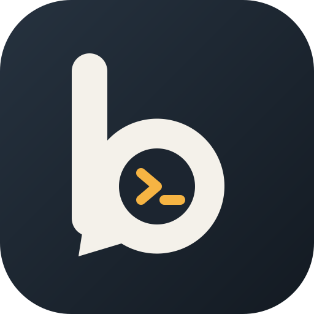

<p align="center"></p>

# beckon

Run Claude Code from Slack, on your own machine, with your own Claude subscription.

Mention `@beckon` with a task. It starts Claude Code in a fresh git worktree of the right repository, shows its steps live in the thread, and posts the answer there. Reply in the thread to keep going. When Claude wants to deploy, push to `main`, merge, run a migration or publish, the command waits in Slack for you to press **Allow** or **Deny**.

```
#myapp
  you      @beckon the signup form accepts empty emails, fix it and open a PR
  beckon   ⏳ Working · 1m 12s
           • Search for `email`
           • Edit `src/routes/signup.ts`
           • Run `npm test`
           • Run `git push -u origin fix/signup-empty-email`
  beckon   Fixed: empty and whitespace-only emails are now rejected, with a test.
           PR: https://github.com/you/myapp/pull/42
  you      looks good, deploy it
  beckon   ✋ approval needed: deploy or change production
           vercel deploy --prod
           [Allow] [Deny]
```

## Why

- **Your machine, your tools.** Claude runs where your repositories, CLIs (`gh`, `vercel`, `wrangler`, `supabase` and so on) and logins already are. It reads each repository's own `CLAUDE.md`, skills, hooks and MCP servers, just like when you run `claude` yourself.
- **Your subscription.** beckon starts the official `claude` CLI, logged in with your Claude plan. It strips `ANTHROPIC_API_KEY` from Claude's environment so a stray key in your shell does not move you to API billing.
- **Safe to leave running.** Risky actions always wait for a button press, whatever the permission mode. Anything that would show a permission prompt also comes to Slack instead of failing. Only the Slack members you list can give beckon work or press its buttons.
- **No public URL.** Slack Socket Mode means beckon opens the connection from your side. It runs behind NAT on a laptop or a home server.

## Requirements

- Node.js 22 or newer, git, and [Claude Code](https://code.claude.com/docs) installed and logged in on the host
- macOS or Linux
- A Slack workspace where you can create an app

## Set up

1. **Install**

   ```sh
   npm install -g github:openyard-cloud/beckon
   beckon init
   ```

   This creates `~/.beckon/config.json` and `~/.beckon/env`.

2. **Create the Slack app.** Open <https://api.slack.com/apps?new_app=1>, choose *From a manifest*, and paste the output of `beckon manifest`. Install the app to your workspace.
   - Copy *OAuth & Permissions > Bot User OAuth Token* (`xoxb-...`) into `~/.beckon/env` as `SLACK_BOT_TOKEN`.
   - Under *Basic Information > App-Level Tokens*, generate a token with the `connections:write` scope. Copy it (`xapp-...`) into the same file as `SLACK_APP_TOKEN`.

3. **Configure** `~/.beckon/config.json`: your Slack member ID (*profile > ⋯ > Copy member ID*), your projects and their channels.

4. **Invite beckon** into each project channel with `/invite @beckon`.

5. **Check and run**

   ```sh
   beckon doctor           # checks node, claude login, git, config and both tokens
   beckon start            # foreground
   beckon service install  # background, starts on login (launchd on macOS, systemd on Linux)
   ```

## Using it

| You do | beckon does |
| --- | --- |
| Mention `@beckon <task>` in a project channel | Starts a new thread, worktree and Claude session |
| Reply in that thread (no mention needed) | Continues the same session |
| DM beckon | Same, in the `defaultProject` |
| Start with `otherproject: <task>` | Uses that project instead |
| Mention `@beckon` inside an existing discussion thread | Reads the thread first, then works on your request |
| Reply `stop`, or press **Stop** | Stops the current run; reply again to continue |
| Mention `@beckon status` | Lists what is running and queued |

Each task runs in its own worktree under `~/.beckon/worktrees`, created from the latest remote copy of the base branch on a detached HEAD. Claude creates a branch with your repository's naming conventions, so several tasks on one repository never collide. A worktree that has been idle for `keepDays` is removed, but only if that loses nothing: uncommitted changes and commits that are not on any branch keep it alive.

## Approvals

Two kinds of requests come to Slack:

1. **Always asked**, even in `bypassPermissions` mode and even when your settings allow the command:
   - a push to `main`, `master`, `production` or `release`, a force push, or a branch delete;
   - `gh pr merge`, releases, repository settings, and `gh api` calls with POST, PUT, PATCH or DELETE;
   - production deploys and changes on Vercel, Cloudflare (`wrangler`), Koyeb, Supabase, Fly, Railway, Netlify, Firebase, EAS and Heroku;
   - publishing to npm, PyPI, crates.io or RubyGems, and `docker push`;
   - Terraform, kubectl, Helm, and changes made with the AWS, Google Cloud and Azure CLIs;
   - direct database clients (`psql`, `mysql`, `mongosh`, `redis-cli`, ...);
   - `sudo`, and recursive deletes outside the worktree;
   - MCP connector tools that deploy, migrate, delete, merge, publish or send messages.

   The full list is in [`src/policy.mjs`](src/policy.mjs). Add your own per project with `alwaysAsk`.

2. **Permission prompts.** These are tool uses your permission mode and allow rules do not already cover. **Allow everything in this thread** stops these prompts for the rest of that thread. Always-asked actions still ask.

When a request is denied, Claude is told not to reach the same result another way. A request nobody answers within `approvalTimeoutMinutes` is denied.

## Config

```jsonc
{
  "users": ["U0123ABCD"],                 // who may give tasks and press buttons
  "projects": {
    "myapp": {
      "path": "~/code/myapp",
      "channels": ["#myapp"],             // names or IDs
      "baseBranch": "main",               // default: the remote's default branch
      "model": "opus",                    // optional
      "permissionMode": "acceptEdits",    // default, acceptEdits, auto, plan, bypassPermissions, dontAsk
      "setup": "npm ci",                  // optional, runs once in each new worktree
      "instructions": "Open PRs as drafts.", // optional, added to Claude's system prompt
      "alwaysAsk": [
        "playwright test",                // a regex on Bash commands
        { "tool": "^(Edit|Write)$", "match": "migrations/", "label": "edit a migration" }
      ]
    }
  },
  "defaultProject": "myapp",              // for DMs; default: the only project
  "schedules": [
    {
      "name": "Morning report",
      "cron": "0 8 * * 1-5",
      "timezone": "Asia/Ho_Chi_Minh",
      "project": "myapp",
      "channel": "#myapp",                // or your member ID for a DM
      "prompt": "Summarize yesterday's merged PRs, failing CI runs and open incidents."
    }
  ],
  "approvalTimeoutMinutes": 60,
  "maxParallel": 3,                       // runs at once; more wait in a queue
  "keepDays": 7,                          // idle worktrees are removed after this
  "claudePath": "claude",
  "allowApiKey": false                    // true keeps ANTHROPIC_API_KEY for claude
}
```

Set `BECKON_HOME` to keep everything somewhere other than `~/.beckon`.

## Running all the time

- **macOS:** `beckon service install` writes a LaunchAgent that starts at login and restarts on crashes. It runs under `caffeinate -i`, so the Mac does not idle to sleep; pass `--no-caffeinate` to allow sleep. A closed lid still sleeps a laptop unless an external display is attached.
- **Linux:** `beckon service install` writes a systemd user unit. Run `sudo loginctl enable-linger $USER` so it keeps running after you log out. On a server without a browser, run `claude setup-token` and put the token in `~/.beckon/env` as `CLAUDE_CODE_OAUTH_TOKEN`.
- **Logs:** `~/.beckon/logs/beckon.log` on macOS, or `journalctl --user -u beckon -f` on Linux.

## Security notes

- **Only listed members.** Anyone not in `users` is ignored, and only listed members can press the buttons. A Slack message is still an instruction to an agent with your access, so keep beckon's channels to people you trust.
- **Approval guards.** The approval hook fails closed. If the beckon process is unreachable, the action is denied.
- **What the rules match.** Always-asked rules match command text, which catches routine mistakes but is not a sandbox. Give the host's CLIs only the access you would give the agent, and protect `main` with branch protection as well.
- **Tokens.** `~/.beckon/env` holds your Slack tokens. `beckon init` creates it with mode 600, and `beckon doctor` fixes the mode if it drifts.

## Terms of use

beckon runs the unmodified `claude` CLI under your own login, for your own work. Anthropic's consumer plans assume ordinary individual use, so run beckon for yourself, not as a shared bot for a team on one person's subscription. For a team, look at [Claude in Slack](https://claude.com/docs/claude-tag/overview) on a Team or Enterprise plan, or use API keys (`"allowApiKey": true`).

## Limits

- Slack file attachments are not passed to Claude yet.
- A new message during a run is queued and sent when the run finishes.
- One machine per Slack app. Two beckon processes on the same app would both answer.

## License

MIT
